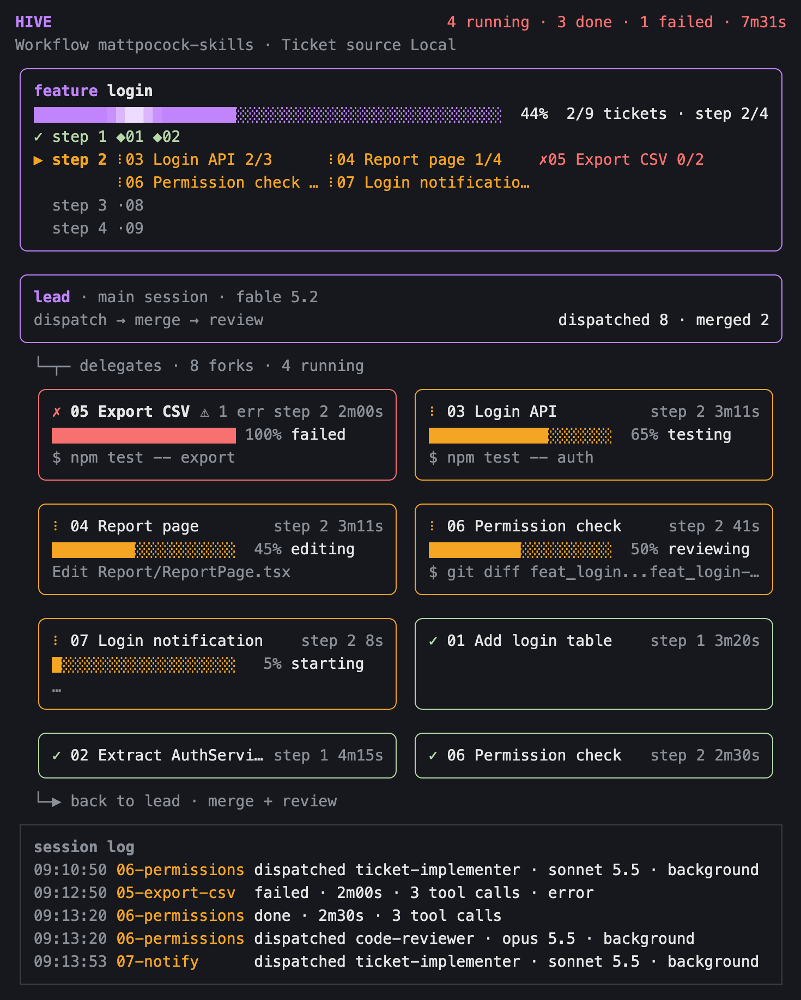
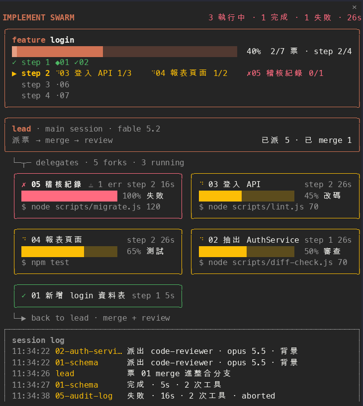

[English](README.md) · [繁體中文](README.zh-TW.md) · [日本語](README.ja.md)

> この文書は翻訳です。内容は[英語版](README.md)が正です。

# hive

チャットの横に置くパネルです。セッション内のサブエージェントが今何をしているかをリアルタイムで表示します。ワークフローを選ぶと、チケット、ステップ、全体の進捗も描画します。



上の図は、`mattpocock-skills` ワークフローで実際に描画される内容を図にしたものです。2 件のチケットがマージ済み、4 つのサブエージェントがそれぞれテスト中、編集中、レビュー中、起動中で、1 つが失敗、3 つが完了しています。

> **0.1 からアップグレードする方へ**：0.1 は implement-spec を実行していることを前提にしていました。0.3 からは既定でサブエージェントの観察のみを行います。以前のフィーチャー枠、ステップ、フェーズバーを戻すには、設定 `workflow` を `mattpocock-skills` にしてください（「[設定](#設定)」を参照）。

> **0.8 からアップグレードする方へ**：0.9 からパネル自身が生成する文字の既定が英語になりました。繁体字中国語のままにするには、設定 `language` を `zh-TW` にしてください（「[設定](#設定)」を参照）。

## インストール

ターミナルセッションのプロンプト欄に入力します。

```
/plugin install hive --marketplace Cyuhsuan/hive
```

続いて `y` を押して marketplace を追加し、インストール範囲を選びます（既定は user）。

シェルからもインストールできます。

```bash
claude plugin install hive --marketplace Cyuhsuan/hive
```

デスクトップアプリでは `/plugin` を実行できません。プロンプト欄の横の + をクリックし、Plugins を選び、`Cyuhsuan/hive` で marketplace を追加してから plugin を追加してください。

### 依存関係

この mod が使うのは Claude Code エンジンが提供する `claude-code` モジュールだけです。npm パッケージ、他の plugin、特定のエージェントタイプ、MCP サーバーは不要で、macOS、Linux、Windows で動作します（パスの `\` と `/` のどちらも認識します）。

GitHub チケットだけは追加で `gh`（GitHub CLI）のログインが必要です。mod はチケットを `gh` 経由でのみ読み込み、トークン付きの HTTP リクエストを自分では送りません。

## 使い方

| コマンド | 動作 |
| --- | --- |
| `/swarm` | パネルを開き、現在のワークフローとチケットソースを表示する |
| `/swarm <issues フォルダ>` | そのフォルダのローカルチケットを読み込む |
| `/swarm #N`、`/swarm <issue URL>` | その GitHub issue を起点にチケットを読み込む（親の spec を持たない issue は「単独チケット」のまとまりとして読み込まれます。「[GitHub チケット](#github-チケット)」を参照） |
| `/swarm reset` | 記録を消去し、観察のみに戻る |

- パネルの幅は、パネルの境界をマウスでドラッグして調整します。内容は自動的に折り返し直されます。
- ステータスバーには「swarm N 実行 · M 完了」と表示されます。ワークフロー画面ではそれに「チケット N/M」が続き、パネルのチケット数と一致します（統合ブランチにマージ済み、またはチケット本体が resolved のチケットは完了として数えます）。
- 状態はセッションの `$.state` に保存されるため、ホットリロードでも失われません。

## 設定

インストール時と `/config` に 3 つの項目が表示されます（ユーザーレベル）。

`workflow`：

| 値 | 意味 |
| --- | --- |
| `none`（既定） | 観察のみ。どの skill やチケットファイルの慣例も認識しません。 |
| `mattpocock-skills` | 組み込みの mattpocock-skills ワークフローを適用します。 |

`animation`：

| 値 | 意味 |
| --- | --- |
| `on`（既定） | サブエージェントの実行中、パネルが動きます。「[アニメーション](#アニメーション)」を参照。 |
| `off` | パネルは静止します。進行中のアイコンは `●` で、2 秒ごとに再描画されます。ターミナルのフォントがスピナーを表示できない場合もこの値を使います。 |

`language`：

| 値 | 意味 |
| --- | --- |
| `en`（既定） | 英語。 |
| `zh-TW` | 繁体字中国語。 |
| `ja` | 日本語。 |

言語の対象は、パネル、ステータスバー、セッションログ、`/swarm` の説明と応答、チケットソースのラベルと失敗理由です。チケット名、サブエージェントの説明、ツールのコマンドなど、読み込んだ内容はそのまま表示します。一覧にない値は未設定、つまり英語として扱います。

セッションの途中で設定を変えると mod が再読み込みされ、新しい値がすぐに反映されます。

- `none` に変更：ワークフロー画面のフィーチャー枠が消えて観察のみに戻ります。サブエージェントカードとログは残ります。
- `mattpocock-skills` に変更：それ以前に見逃したきっかけは遡って拾いません。次のきっかけでチケットを読み込みます。

## アニメーション

アニメーションが表すのは 1 つだけで、サブエージェントが実行中であることです。実行中のサブエージェントがないときは、パネルは完全に静止します。



- **サブエージェントカードのステータスドット**：まだ実行中のカード（起動直後とレビュー中を含む）は回転するスピナー（`⠋⠙⠹⠸⠼⠴⠦⠧⠇⠏`）になります。完了と失敗のカードは `✓`、`✗` のままです。
- **チケットのアイコン**：サブエージェントが作業しているチケットのアイコンは、そのカードのスピナーと同じ位置で同期して回ります。進行中でもサブエージェントが作業していないチケットは動きません。
- **フィーチャーの進捗バー**：やわらかい光の帯が、塗りつぶされた部分を左から右へ約 2 秒で流れます。左端でフェードインし、先頭でフェードアウトし、未完了の部分には当たりません。進捗が 0%、100% のとき、またはサブエージェントが実行中でないときは光の帯はありません。

サブエージェントカードのフェーズ進捗バーとステータスバーは動きません。アニメーション中、パネルは約 0.06 秒ごとに再描画されますが、パネルが表示されているときだけです。

## 観察のみ

派遣されたサブエージェントはすべて記録されます。パネルは自動では開かず、ステータスバーだけが更新されます。`/swarm` を入力すると開きます。

- **リード枠**：メインセッションとそのモデル、そしてこれまでに派遣したサブエージェントの数。
- **サブエージェントカード**：タイトルはサブエージェントの説明とタイプです。2 行目は現在の動作（読込、編集、テストなど、ツール呼び出しから推定したもの）とツール呼び出しの回数です。エラーがあると `⚠ N err` が表示され、失敗したカードは先頭に並び、赤い枠になります。実行中と失敗のカードはすべて表示し、完了したカードは直近 5 件だけを表示します。残りは「ほか N 件完了」の 1 行にまとめます。
- **セッションログ**：直近 5 件の派遣、完了、失敗。

`none` でも、`/swarm <issues フォルダ>` はそのフォルダのローカルチケットを読み込みます。

## ワークフロー画面（`mattpocock-skills`）

### 開始のきっかけ

次のいずれかのときに、パネルが自動で開いてチケットを読み込みます。

1. メインセッションが `/implement-spec` を呼び出す、またはあなた自身が `/implement-spec` を入力する（どちらも同じ動作です。再実行するとリセットしてやり直します。古いチケット、終了したサブエージェントカード、ログは消え、実行中のカードは残りますが、どのチケットにも対応しなくなります）。
2. 派遣されたサブエージェントのプロンプトがチケット（`…/issues/NN-*.md`）を指している。
3. あなたが `/swarm <issues フォルダ>` を入力する。

2 または 3 で入った場合、それ以前に記録されたサブエージェントは、入ったことでは消えません。その後に別のチケット群へ切り替わったとき、終了したカードが消えます（下記参照）。チケットソースが GitHub の場合、このチケット群がすべて完了（統合ブランチにマージ済み、またはチケット本体が resolved）したあとで、サブエージェントのプロンプトが別の spec のチケット、または開いている単独チケット（親の spec を持たない issue）を指すと、パネルはそのチケット群を読み込み直します。終了（完了または失敗）したサブエージェントカードは消え、実行中のカードとログは残ります。このチケット群に未完了のチケットがあるうちは切り替わりません。例外は単独チケットのまとまりです。完了していてもいなくても、プロンプトが別の単独チケットを指せばこのまとまりに加わります（ある spec のチケットを指す場合は上のルールに従います）。チケットソースがローカルのチケットファイルの場合は「完了してから切り替える」という制限はありません。プロンプトが別のフォルダのチケットファイル（`…/issues/NN-*.md`）を指すと、パネルはそのフォルダを読み込み直し、同じように終了したカードを消します。`/swarm` が別のチケット群（`#N`、issue URL、フォルダ）を指す場合も切り替えで、結果は同じです。同じチケット群の再読み込み、同じ spec への子チケットの追加、単独チケットのまとまりへの別の単独チケットの追加、最初のチケット群の読み込み、読み込みの失敗は切り替えに数えず、カードは動きません。「切り替え」は画面に出ているチケット群を基準にします。設定を `none` に変えると、状態には以前のチケット群が残っていても画面は観察のみなので、このとき `/swarm <フォルダ>` は最初のチケット群の読み込みとして扱われ、終了したカードは消えません。サブエージェントのタイプや説明に implement、review、merg などの語が含まれていても、何も起動しません。いったんワークフロー画面に入ると、`/swarm reset` か新しいセッションまで、自動で観察のみに戻ることはありません。

### 画面の内容

観察のみの内容に加えて、次が表示されます。

- **ワークフローのステータス行**：たとえば「ワークフロー mattpocock-skills · チケットソース ローカル」。チケットソースが使えない場合は、同じ行に理由を示します。
- **フィーチャー枠**：全体の進捗バー（統合ブランチにマージ済み、またはチケット本体が resolved のチケットは 1 件分まるごと、それ以外はチェック済みの受け入れ条件の割合で計算）、チケット数と現在のステップ、その下にステップごとに 1 行。作業中のステップはチケット名と受け入れ条件の数まで書き、ほかのステップは「アイコン + チケット番号」だけを描きます。
- **リード枠**には、マージしたチケットの数も表示されます。
- **チケットを指すサブエージェントのカード**：タイトルはチケット番号と名前、所属ステップ、経過時間です。2 行目はフェーズ進捗バー（読込中 → 編集中 → テスト中 → マージ中 → コミット中）、3 行目は直近のツール呼び出しです。チケットを指さないサブエージェントは、観察のみのサブエージェントカードのままです。

チケットのアイコンと色は、そのチケットを担当するサブエージェントカードのステータスドットと枠の色と同じ体系です。

| アイコン | 意味 |
| --- | --- |
| `◆` 淡い緑 | 統合ブランチにマージ済み |
| `✓` 淡い緑 | チケット本体が resolved / サブエージェントが完了 |
| スピナー、黄 | サブエージェントが作業中（`animation` が `off` のときは `●`） |
| `✗` 赤 | 失敗 |
| `○` | 着手可能 |
| `·` 灰 | 前のチケットにブロックされている |

フェーズはサブエージェントのツール呼び出しから推定します。名前に edit／write／replace／insert を含むツールは「編集中」、`dotnet test`、`npm test` などは「テスト中」、`git merge` は「マージ中」、`git commit` は「コミット中」として扱います。タイプ名に review を含むサブエージェントは常に「レビュー中」と表示します。

パネルの幅が 40 桁より狭いときは自動で簡略化します。サブエージェントカードのタイトルにはチケット番号とフェーズだけを残し、ログにはチケット番号だけを残します。枠とトポロジー線は残ります。

### チケットソース

チケットを読み込む前に、mod はプロジェクトの `docs/agents/issue-tracker.md` を読み、1 行目のタイトルでチケットソースを判断します。

| 1 行目 | 結果 |
| --- | --- |
| `# Issue tracker: Local Markdown`、またはファイルがない | ローカルチケット：`.scratch/<feature>/issues/NN-*.md` |
| `# Issue tracker: GitHub` | チケットは GitHub issue です。次の節を参照 |
| `# Issue tracker: GitLab`、または判別できない | 観察のみのままにし、ステータス行に理由を示す |

このファイルはチケットを読み込むたびに読み直され、ユーザーが `/swarm` を入力したときも読みます。セッション開始時には読みません。`/swarm reset` のあとで改めて判断します。

### GitHub チケット

- **起点**：spec issue 1 件。番号は `/implement-spec` の引数、または `/swarm #N`／`/swarm <issue URL>` から取ります。このチケット群はその sub-issue です。sub-issue がない場合は、本文の `Part of #N` または `## Parent` セクションでその issue を指している issue です。
- **単独チケット**：親の spec を持たない（parent がなく、本文にも `Part of #N` や `## Parent` がない）issue。同じ作業（パネルのリセットから次のリセットまで）の中の単独チケットは同じまとまりに描かれ、枠の名前は常に「単独チケット」で、spec のチケットとは同じまとまりに混ざりません。依存関係、進捗、マージ、再読み込みは spec のまとまりと同じです。
  - **引数からの読み込み**：引数（`/implement-spec`、`/swarm`）にあるすべての `#N`、issue URL、数字だけの値を、出てきた順に判断します。spec（子チケットを持つ issue）またはある spec の子チケットがあれば、最初の spec のまとまりを読み込み、残りの番号は無視します。なければ、これらのチケットが単独チケットのまとまりになり、1 件だけでもそう扱います。存在しない番号と PR は読み飛ばし、すべて読み飛ばされたときは、チケットを読み込めないと表示します。そのため、まだチケットに分割されていない spec は 1 件の単独チケットとして描かれます。「数字だけの値」とは引数全体が数字であることです（`/swarm 30 31` など）。`#N` や URL と混ぜた場合、数字だけの値は数えません（`#30 31` は 30 だけを取ります）。`/swarm #N` が単独チケットを指し、パネルがすでに単独チケットのまとまりであれば、そのまとまりに加わり（`merged`、サブエージェントカード、ログは残ります）、リセットはしません。開始 skill は常に新しいまとまりから始めます。
  - **サブエージェントのプロンプトからの追加**：プロンプトの最初の 3 つの番号を出てきた順に見て、最初に当てはまったものを採用します。親の spec があるものは spec のチケット、親がなく、開いていて、PR でないものは単独チケットです（閉じた issue と PR が単独チケットになることはありません）。
- **依存関係と進捗**：チケットをブロックするチケットは GitHub 標準の blocked-by 関係から取ります。ない場合は本文の `## Blocked by` セクションにある `#N` を読み、同じまとまりのチケットだけを数えます。閉じた issue は resolved です。統合ブランチにマージ済みのチケットは、まだ閉じていなくても完了として扱います。それ以外は本文の `- [ ]`／`- [x]` で進捗を数えます。
- **サブエージェントのプロンプトからの読み込み**：まだチケットを読み込んでいないとき、サブエージェントのプロンプトにある issue URL や `#N` から parent が引ければ、parent を起点に読み込みます。読み込み後は、このチケット群に属する番号だけがチケットに対応し、ほかの番号（たとえば PR）は観察のみのカードのままです。
- **merge**：メインセッションの merge コマンド（ブランチ名にチケット番号を含む。例：`ticket-12`）が成功すると、マージ済みとして印を付けます。対応しないときは、クローズ状態だけで表示します。
- **再読み込み**：サブエージェントの実行中は 30 秒ごとに読み直し、サブエージェントの終了時と merge の検出時にもすぐ読み直します。メインセッションが `gh issue close`、`gh issue reopen`、`gh issue edit` を成功させたあとにも 1 回読みます（サブエージェントによる実行は数えません）。チケット群を読み込み済みのときは、引数なしの `/swarm` でも読み直します。
- **失敗時**：ログイン済みの `gh` 経由で読み込み、チケットを読み込むときにだけ呼び出します。`gh` が見つからない、未ログイン、呼び出しの失敗のときは観察のみのままにし、ステータス行に理由を示します（例：「チケットソース GitHub（`gh` 未ログイン）」）。読み込み済みのチケットは、再読み込みに失敗しても残ります。
