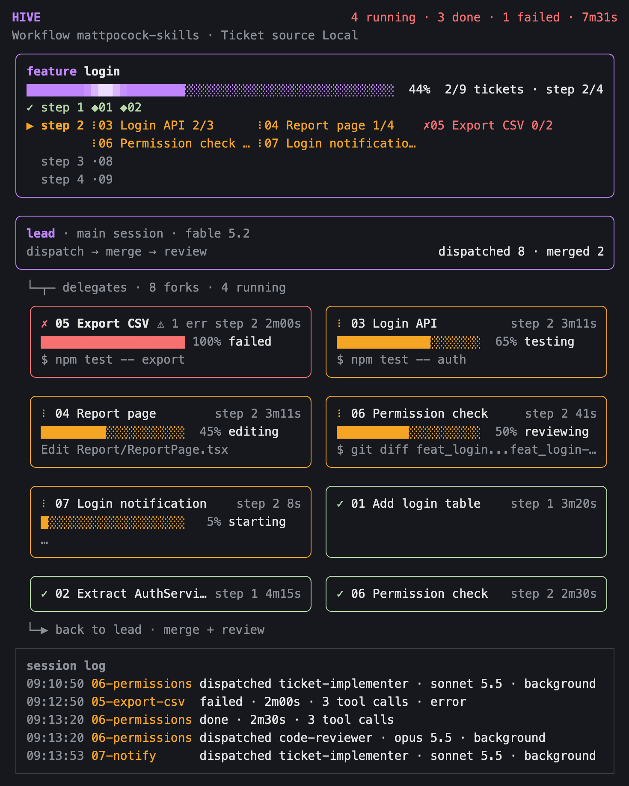
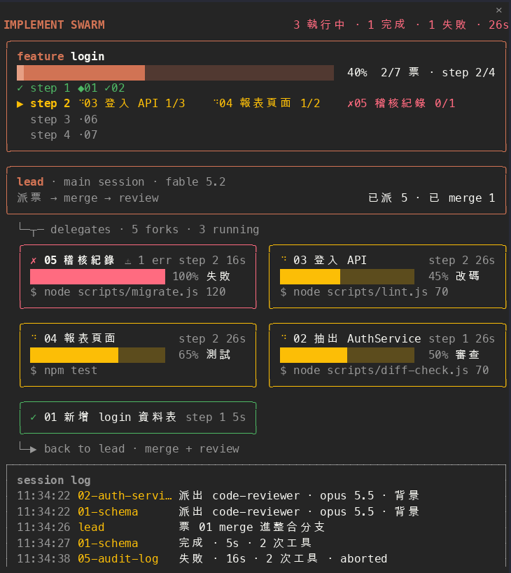

# hive

一個面板，貼在對話旁邊，即時呈現 session 裡的子代理在做什麼；選用工作流後，還會畫出票、時間步與整體進度。



上圖是 `mattpocock-skills` 工作流下實際畫出的內容轉成的示意圖：兩張票已 merge，四個子代理分別在測試、改碼、審查與啟動中，一個失敗，三個完成。

> **從 0.1 升級的使用者**：0.1 版假設你在跑 implement-spec。0.3 起預設只觀察子代理，要拿回原本的 feature 框、時間步與階段條，請把設定 `workflow` 改成 `mattpocock-skills`（見「[設定](#設定)」）。

## 安裝

在終端機 session 的提示列輸入：

```
/plugin install hive --marketplace Cyuhsuan/hive
```

接著按 `y` 加入 marketplace，再選安裝範圍（預設是 user）。

也可以從 shell 安裝：

```bash
claude plugin install hive --marketplace Cyuhsuan/hive
```

桌面 app 不能執行 `/plugin`：點提示框旁的 +，選 Plugins，用 `Cyuhsuan/hive` 加入 marketplace，再加入 plugin。

### 相依

這個 mod 只用 Claude Code 引擎提供的 `claude-code` 模組，不需要 npm 套件、其他 plugin、特定的 agent 類型或 MCP 伺服器，macOS、Linux、Windows 都能用（路徑的 `\` 與 `/` 都認得）。

只有 GitHub 票需要額外的東西：已登入的 `gh`（GitHub CLI）。mod 只透過它讀票，不自行以 HTTP 帶 token。

## 使用

| 指令 | 作用 |
| --- | --- |
| `/swarm` | 打開面板，並顯示目前的工作流與票來源 |
| `/swarm <issues 資料夾>` | 載入那個資料夾的本地票 |
| `/swarm #N`、`/swarm <issue 網址>` | 以那個 GitHub issue 為起點載入票（沒有上層 spec 的 issue 載入為「獨立票」那一批，見「[GitHub 票](#github-票)」） |
| `/swarm reset` | 清空紀錄，回到純觀察 |

- 面板寬度用滑鼠拖曳面板邊界調整，面板內容會跟著重排。
- 狀態列會顯示「swarm N 跑 · M 完」；工作流畫面下再接「票 N/M」，與面板的票數一致（已併回整合分支或票面為 resolved 的票都算做完）。
- 狀態存在 session 的 `$.state`，熱重載不會遺失。

## 設定

安裝時與 `/config` 都會出現兩個欄位（使用者層級）。

`workflow`：

| 值 | 意思 |
| --- | --- |
| `none`（預設） | 純觀察。不認得任何 skill 或票檔慣例。 |
| `mattpocock-skills` | 套用內建的 mattpocock-skills 工作流。 |

`animation`：

| 值 | 意思 |
| --- | --- |
| `on`（預設） | 有子代理執行時面板會動，見「[動畫](#動畫)」。 |
| `off` | 面板靜止：進行中的圖示是 `●`，每 2 秒重畫一次。終端機字型顯示不出 spinner 時也用這個值。 |

session 進行中改設定會讓 mod 重新載入，新值立刻生效：

- 改成 `none`：工作流畫面的 feature 框消失、回到純觀察，子代理卡與 log 保留。
- 改成 `mattpocock-skills`：不回頭補認先前錯過的時機，等下一個時機才載入票。

## 動畫

動畫只代表一件事：有子代理正在執行。沒有子代理執行時，面板完全靜止。



- **子代理卡的狀態點**：還在跑的卡（包含剛派出與審查中的）是一個轉動的 spinner（`⠋⠙⠹⠸⠼⠴⠦⠧⠇⠏`）；完成與失敗的卡維持 `✓`、`✗`。
- **票的圖示**：有子代理正在做的票，圖示與那張卡的 spinner 同一格、同步轉動。進行中但沒有子代理在做的票不動。
- **feature 進度條**：一道柔和的光帶在已填滿的那一段由左往右滑過，約 2 秒一趟，從左端淡入、在前緣淡出，不會照到未完成的部分；進度是 0%、100%，或沒有子代理執行時沒有光帶。

- **蜜蜂與回巢**：執行中的子代理卡（包含剛派出與審查中的）上有一隻 `🐝`，沿卡片上緣的框線左右來回飛。它疊在框線上，不佔卡片的格子，標題、右側資訊與卡片寬度都不變。子代理完成時，蜜蜂約 1 秒內飛出卡片邊緣後消失（回巢），卡片就是平常的完成卡；失敗的子代理不回巢，蜜蜂直接消失，卡片維持紅框與 `✗`。lead 框第二行在「已派 N」（工作流畫面再加「已 merge M」）之後顯示 `🐝 K`，K 是已完成（不含失敗）的子代理數，為 0 時不顯示。回巢只看「完成時間距今多久」，錯過的不補演：面板當時沒顯示、或重新載入後才重畫，直接看到結果。窄於 40 欄時行為相同。

子代理卡的階段進度條與狀態列不動。動畫進行時面板約每 0.06 秒重畫一次，只在面板顯示中才重畫；最後一個子代理完成後，面板會繼續重畫到回巢結束才靜止。

`animation` 為 `off` 時：執行中的卡上是一隻位置固定的蜜蜂，沒有飛行與回巢，子代理完成後蜜蜂立刻消失；lead 框的數量照常顯示。

## 純觀察

任何子代理被派出都會被記錄。不會自動打開面板，只更新狀態列；輸入 `/swarm` 才打開。

- **lead 框**：主 session 與它的模型，以及已派出幾個子代理。
- **子代理卡**：標題是子代理的描述與類型；第二行是目前在做什麼（讀、改、測試這類從工具呼叫推估的動作）與工具呼叫次數。有錯誤時出現 `⚠ N err`，失敗的卡排最前、紅框。執行中與失敗的全部列出，完成的只列最近 5 個，其餘收成一行「另有 N 個已完成」。
- **session log**：最近 5 筆派出、完成與失敗。

`none` 下，`/swarm <issues 資料夾>` 仍會載入那個資料夾的本地票。

## 工作流畫面（`mattpocock-skills`）

### 何時進入

在下列時機之一，面板自動打開並載入票：

1. 主 session 呼叫 `/implement-spec`，或你自己輸入 `/implement-spec`（兩種做法行為相同；再次執行會重置並重新開始：舊的票、已結束的子代理卡與 log 清掉，還在執行的子代理卡留著，但不再對應任何票）；
2. 派出的子代理 prompt 指到票（`…/issues/NN-*.md`）；
3. 你輸入 `/swarm <issues 資料夾>`。

由 2 或 3 進入時，先前已記錄的子代理不會因為進入而消失；之後若換成另一批票，已結束的卡才清掉（見下）。票來源是 GitHub 時，這批票全部做完（已併回整合分支或票面 resolved）後，若子代理的 prompt 指到另一份 spec 的票，或指到一張開啟中的獨立票（沒有上層 spec 的 issue），面板會改載那一批票，已結束（完成或失敗）的子代理卡清掉、還在執行的卡與 log 保留；這批還有票沒做完時不換批。例外是獨立票那一批：不管做完沒，prompt 指到另一張獨立票就加入這一批（指到某份 spec 的票則照上面的規則）。票來源是本地票檔時沒有「做完才換」的限制：prompt 指到另一個資料夾的票檔（`…/issues/NN-*.md`），面板就改載那個資料夾，同樣清掉已結束的卡。`/swarm` 指到另一批票（`#N`、issue 網址、資料夾）也是換批，結果相同；重讀同一批、同一份 spec 新增子票、獨立票那一批加入另一張獨立票、載入第一批、載入失敗都不算，卡不動。「換批」以畫面上的那一批為準：設定改成 `none` 後，狀態裡雖然還留著先前的一批票，畫面是純觀察，這時 `/swarm <資料夾>` 算載入第一批，已結束的卡不清。子代理的類型或描述含 implement、review、merg 之類的字樣不會啟動任何東西。一旦進入工作流畫面，就不會自動回到純觀察，直到 `/swarm reset` 或新的 session。

### 畫面內容

在純觀察的內容之上多了：

- **工作流狀態行**：例如「工作流 mattpocock-skills · 票來源 本地」，票來源無法使用時在同一行說明原因。
- **feature 框**：整體進度條（已併回整合分支或票面 resolved 的票算整張，其餘按勾掉的驗收項目比例算）、票數與目前步驟，下面每個時間步一列。正在做的那一步會寫出票名與驗收數，其他步驟只畫「圖示 + 票號」。
- **lead 框**多了已 merge 幾張票。
- **指到票的子代理卡**：標題是票號與票名、所在步驟與耗時；第二行是階段進度條（讀碼 → 改碼 → 測試 → merge → commit）；第三行是最近一次工具呼叫。沒有指到票的子代理仍是純觀察的子代理卡。

票的圖示與顏色，和負責它的子代理卡的狀態點與框色是同一套：

| 圖示 | 意思 |
| --- | --- |
| `◆` 綠 | 已 merge 進整合分支 |
| `✓` 綠 | 票面 resolved／子代理完成 |
| spinner 黃 | 有子代理正在做（`animation` 為 `off` 時是 `●`） |
| `✗` 紅 | 失敗 |
| `○` | 可以開始 |
| `·` 灰 | 被前面的票擋住 |

階段是從子代理的工具呼叫推估的：名稱含 edit／write／replace／insert 的工具算改碼，`dotnet test`、`npm test` 等算測試，`git merge` 算 merge，`git commit` 算 commit。類型名稱含 review 的子代理一律顯示為審查。

面板窄於 40 欄時自動精簡：子代理卡標題只留票號與階段，log 只留票號，框與拓撲線都保留。

### 票來源

載入票之前，mod 先讀專案的 `docs/agents/issue-tracker.md`，以第一行標題判斷票來源：

| 第一行 | 結果 |
| --- | --- |
| `# Issue tracker: Local Markdown`，或檔案不存在 | 本地票：`.scratch/<feature>/issues/NN-*.md` |
| `# Issue tracker: GitHub` | 票是 GitHub issue，見下節 |
| `# Issue tracker: GitLab` 或認不出來 | 維持純觀察，狀態行說明原因 |

這個檔案在每次要載入票時重讀，使用者輸入 `/swarm` 時也會讀；session 開始時不讀。`/swarm reset` 之後重新判斷。

### GitHub 票

- **起點**：一個 spec issue，編號來自 `/implement-spec` 的參數或 `/swarm #N`／`/swarm <issue 網址>`。這批票是它的 sub-issue；沒有 sub-issue 時，是內文以 `Part of #N` 或 `## Parent` 區段指向它的 issue。
- **獨立票**：沒有上層 spec（沒有 parent，內文也沒有 `Part of #N` 或 `## Parent`）的 issue。同一次工作（從面板重置到下一次重置）裡的獨立票畫在同一批，框名固定為「獨立票」，不和 spec 的票混在同一批；相依、進度、merge、重讀都和 spec 的那一批相同。
  - **從參數載入**：參數（`/implement-spec`、`/swarm`）裡所有的 `#N`、issue 網址與單獨的數字依出現順序判斷。有 spec（有子票的 issue）或某份 spec 的子票時，載入第一份 spec 的那一批，其餘編號忽略；否則這些票湊成獨立票那一批，只有一張也算。不存在的編號與 PR 略過，全部略過時說明讀不到票。一份還沒拆票的 spec 因此會被畫成一張獨立票。「單獨的數字」指整串參數都是數字（如 `/swarm 30 31`）；和 `#N` 或網址混寫時，單獨的數字不算（`#30 31` 只取 30）。`/swarm #N` 指到獨立票時，若面板上已是獨立票那一批就加入它（`merged`、子代理卡、log 保留），不是重置；起始 skill 則一律從新的一批開始。
  - **從子代理 prompt 加入**：依出現順序看 prompt 的前三個編號，第一個符合的算數：有上層 spec 的是 spec 的票，沒有上層、開啟中、不是 PR 的是獨立票（已關閉的 issue 與 PR 不會成為獨立票）。
- **相依與進度**：擋住一張票的票取自 GitHub 原生的 blocked-by 關係；沒有時讀內文 `## Blocked by` 區段的 `#N`，只計入同一批的票。已關閉的 issue 是 resolved；已併回整合分支的票即使還沒關閉也算做完；其餘依內文 `- [ ]`／`- [x]` 計進度。
- **從子代理 prompt 載入**：還沒載入票時，子代理 prompt 裡的 issue 網址或 `#N` 若查得到 parent，就以 parent 為起點載入；載入後，只有屬於這批票的編號才對上票，其他編號（例如 PR）仍是純觀察的卡。
- **merge**：主 session 的 merge 指令（分支名含票號，如 `ticket-12`）成功後標記為已 merge；對不上時只依關閉狀態呈現。
- **重讀**：有子代理執行時每 30 秒重讀一次，子代理結束與偵測到 merge 時立刻再讀；主 session 成功執行 `gh issue close`、`gh issue reopen` 或 `gh issue edit` 後也讀一次（子代理執行的不算）；已載入一批票時，`/swarm` 不帶參數也會重讀。
- **失敗時**：透過已登入的 `gh` 讀取，只在要載入票時才呼叫；`gh` 不存在、未登入或呼叫失敗時維持純觀察，狀態行寫出原因（例如「票來源 GitHub（`gh` 未登入）」），已載入的票在重讀失敗時保留。
